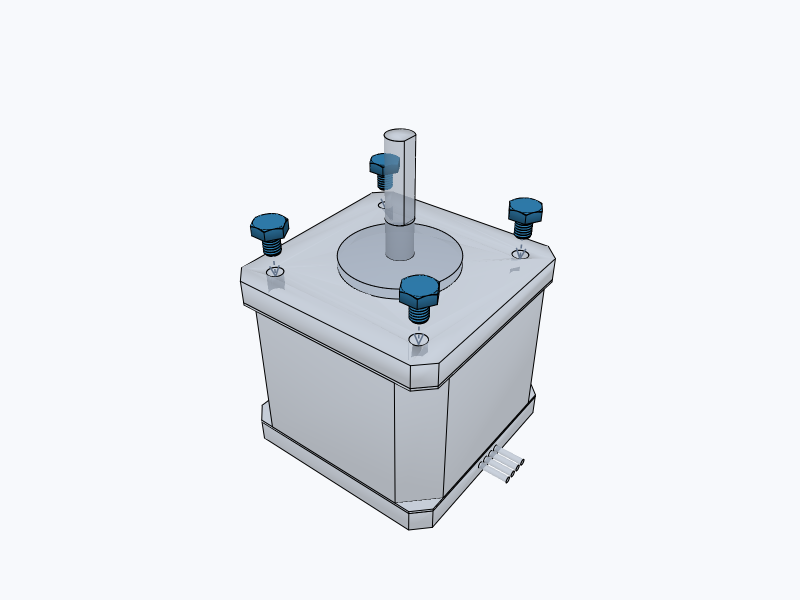
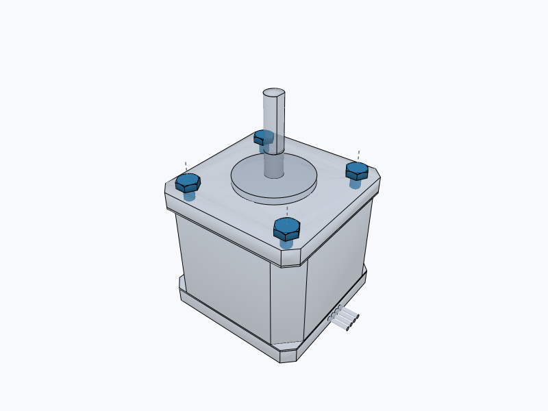
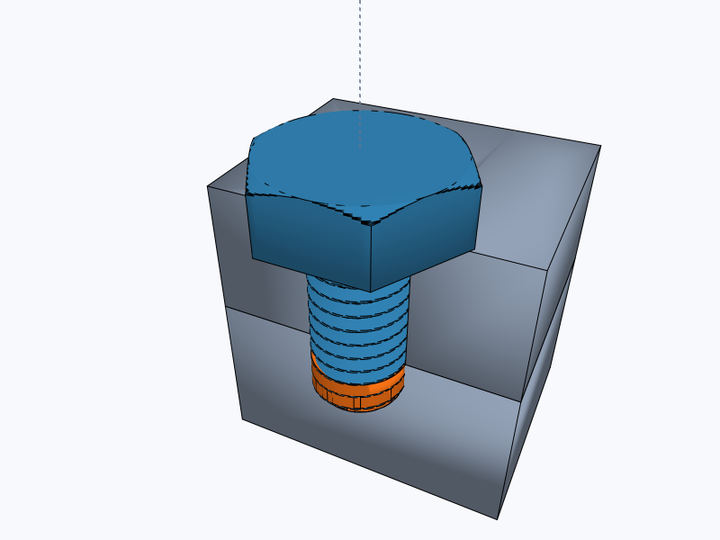

# @tscircuit/cad-collision-checking

Continuous collision checking for CAD assembly translations, implemented as an
iterative `BaseSolver` from `@tscircuit/solver-utils`. The solver accepts closed
triangle meshes and ordered movements. Collision detection is independent of
tscircuit/core, Circuit JSON, JSCAD and rendering. The optional visualization uses
the scene types from `graphics-debug-3d`.


The 3D visualization uses released `graphics-debug-3d@0.0.1` for PoppyGL
snapshots and interactive navigation, with the custom-renderer hook from
`solver-utils@0.0.25` for the debugger controls.

## Install

```sh
bun add https://jscdn.tscircuit.com/@tscircuit/cad-collision-checking/0.0.3.tgz
bun add https://jscdn.tscircuit.com/@tscircuit/graphics-debug-3d/0.0.1.tgz
bun add @tscircuit/solver-utils graphics-debug
```

The package ships TypeScript source following the handbook's source-package
convention. GitHub Packages releases are available through jscdn; consumers such
as core bundle the library. Manifold 3.5.4 supplies the geometry kernel.

## Use

```ts
import {
  CadCollisionCheckingSolver,
  loadCollisionManifold,
  type CadCollisionProblem,
} from "@tscircuit/cad-collision-checking"

await loadCollisionManifold()
const problem: CadCollisionProblem = {
  solids: [
    /* { solidId, name, mesh } */
  ],
  moves: [
    {
      moveId: "lift-cover",
      name: "Lift cover and bolts",
      solidIds: ["cover", "bolt1", "bolt2"],
      translation: [0, 0, 24],
    },
  ],
}
const solver = new CadCollisionCheckingSolver(problem)
try {
  solver.solve() // Or call step() to inspect each unit of work.
  console.log(solver.getOutput().collisions)
} finally {
  solver.dispose()
}
```

Coordinates are right-handed world millimetres: +X right, +Y top, +Z above.
`mesh.vertProperties` and `mesh.triVerts` are ordinary JSON arrays, with `numProp`
giving the vertex stride (the first three properties are XYZ points). Optional
`mergeFromVert`/`mergeToVert` arrays preserve topology across duplicated vertices.
Use `serializeCollisionMesh(manifoldSolid)` to copy a borrowed Manifold solid.
The solver copies its input and never changes caller-owned geometry.

`loadCollisionManifold()` loads the installed WASM package in Node/Bun and pinned
jsDelivr assets in browsers. Await it before constructing a solver. Alternatively,
pass an initialized module as the second argument, `{ manifold }`, for custom
hosting. Downloaded constructor inputs contain only the problem, so they can be
replayed after initialization without serializing a WASM module.

## Collision semantics

- Movements execute in array order. All solids selected by one movement travel
  together; duplicate selections move once. Expand assembly/stage membership to
  solid IDs in the caller.
- Leading mesh triangles sweep prisms whose union covers the continuous path.
  Holes and concavities remain intact; this is not endpoint sampling or a convex
  hull of the whole part.
- Only newly occupied space is checked. The solid's starting occupied space is
  subtracted for each movement, allowing an existing overlap to separate while
  detecting movement deeper into an obstacle.
- Zero-volume face contact is allowed. Positive intersection volume is compared
  with Manifold's numerical tolerance.
- A collision identifies `moveId`, `movingSolidId`, `obstacleSolidId`, and
  `sweptIntersectionVolumeMm3`. That volume describes obstacle material in the
  newly swept space; it is not penetration depth or first-contact time.
- `solved` means the check completed, including any collisions it found. It does
  not mean collision-free. Missing targets, invalid meshes, and exhausted or
  abandoned checks cannot return a successful result.

The caller owns model loading, tessellation, placement transforms, unsupported
geometry warnings, and application-specific diagnostics. Core's adapter preserves
its `cad_explosion_collision_error` and incomplete-check warnings. This library
checks rigid translations of supplied meshes; rotations, flexible bodies,
thread engagement, and unprovided geometry are outside its coverage. Fastener
meshes themselves, including modeled threads and sockets, are checked normally.

## Real motor and fastener regression

The NEMA17 fixture regenerates `nema17`, `hexbolt_m3_l4`, and `hexbolt_m3_l6`
from pinned `modelprinter@0.0.35` and `jscad-electronics@0.0.242`. It imports
closed triangle meshes through the shared `geom3ToIndexedMesh` conversion,
including the motor's shaft, wires, rear screws, blind mounting holes, and the
bolts' helical threads. The M3 × 4 bolt has over 42,000 triangles. Bounding boxes
only reject distant pairs; the narrow phase checks continuous mesh sweeps.
No whole-part boxes, convex hulls, mesh decimation, or time sampling replace
these models.




The stock motor models **smooth 3 mm bores**, not internal threads or a specified
manufacturing tolerance. The M3 bolt's major diameter is also 3 mm. JSCAD boolean
snapping and mesh tessellation introduce microscopic overlaps in this nominal
zero-clearance pair. A dedicated test preserves this diagnostic (less than
0.005 mm³ of newly swept intersection); it is not silently treated as a fit.

The separate fit variant explicitly sets `mountingHoleDiameter: 3.02`, giving
10 µm nominal radial clearance. All four threaded bolts fit, a 5 µm lateral
offset still clears, and a 20 µm offset collides with the bore wall. Other tests
move the motor around stationary bolts in a rotated scene, detect collisions
between clear endpoint poses, and verify an M3 × 6 bolt strikes the 4.5 mm blind
hole floor while its head stays above the mounting face. These are rigid mesh
clearance checks, not a simulation of screwing into a tapped hole.



Select **nema17-m3** in the debugger to switch between fit, wall, floor, and
stock-model cases. Close-ups section the actual motor mesh **for display only**;
the collision solver always receives the complete motor. PoppyGL snapshots and
the interactive view share the same camera fixtures. Full threaded-mesh sweeps
are synchronous and take several seconds per bolt.

## Debug and test

```sh
bun install
bun run start       # React Cosmos: thin wall, grouped movement, bores, NEMA17/M3
bun test
bun run typecheck
bun run format:check
bun run build:site
```

The fixtures use `GenericSolverDebugger`, with single-step/solve/animate controls,
live stats, downloadable constructor inputs, and a Three.js/OrbitControls 3D view.
Orange geometry shows actual swept intersections. `getConstructorParams()`,
`getOutput()`, and `computeProgress()` follow solver-utils patterns.
`visualize3d()` returns serializable `GraphicsObject3d` meshes, movement lines,
labels, stable bounds, and optional `cameraPosition`/`cameraTarget`. The debugger uses the custom-renderer hook instead of
projecting 3D geometry into the inherited 2D `visualize()` format.
Snapshots use PoppyGL. The interactive view supports orbit, pan, zoom, axis views,
fit/reset and copying a camera fixture, and preserves navigation across solver
steps. Pass the copied fields to `visualize3d({ cameraPosition, cameraTarget })`
to include them in the serializable output. The grouped fixture shares its authored
camera with all three PoppyGL stage snapshots; camera settings stay outside the
collision problem and algorithm. Blue shows
moving solids, translucent gray shows stationary obstacles, and orange shows
actual swept intersection volume. The movement guides are not collision samples.


Each step prepares one solid, constructs a sweep, checks one candidate obstacle,
or applies one target translation. Individual native geometry operations are
synchronous. Call `dispose()` if abandoning an unfinished solver; completion and
failure release native solids automatically.

This repository was provisioned through
[tscircuit/create-repo #103](https://github.com/tscircuit/create-repo/pull/103)
and follows the [handbook](https://github.com/tscircuit/handbook/blob/main/guides/bootstrapping-repos.md).
