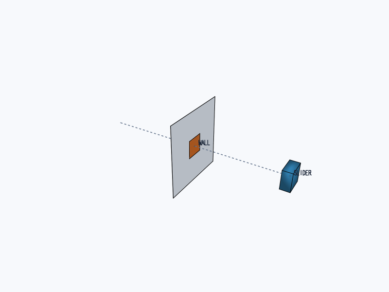
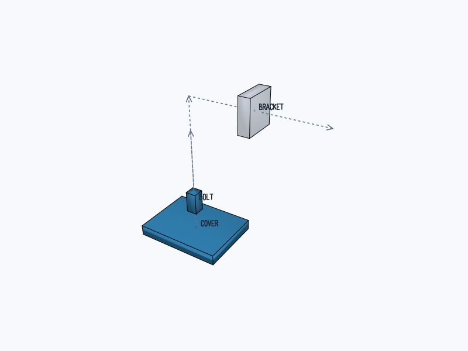
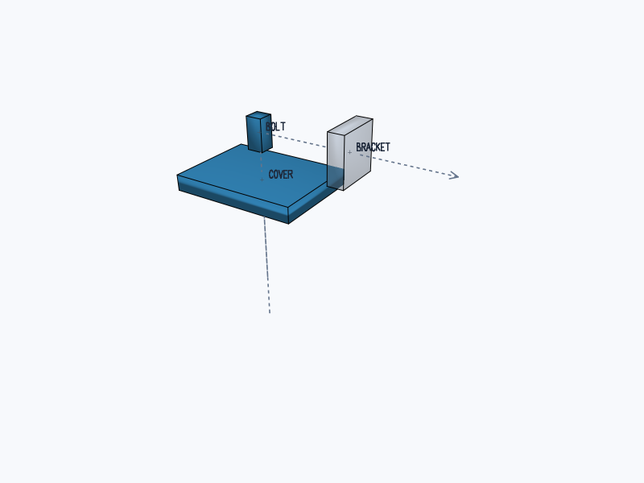
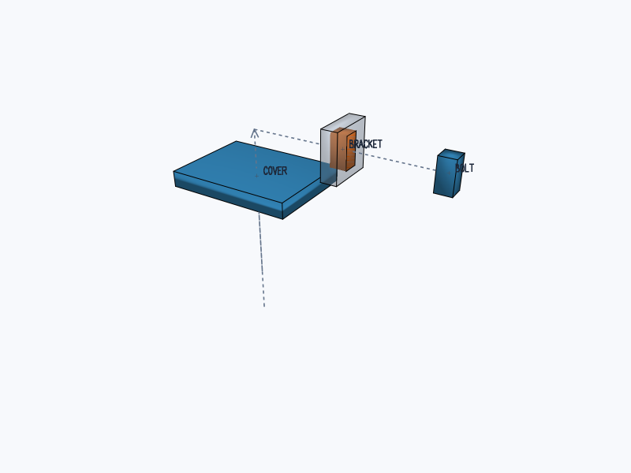

# @tscircuit/cad-collision-checking

Continuous collision checking for CAD assembly translations, implemented as an
iterative `BaseSolver` from `@tscircuit/solver-utils`. The solver accepts closed
triangle meshes and ordered movements. It has no dependency on tscircuit/core,
Circuit JSON, JSCAD, or a renderer.



The 3D integration in this branch depends on
[graphics-debug-3d #1](https://github.com/tscircuit/graphics-debug-3d/pull/1) and
[solver-utils #54](https://github.com/tscircuit/solver-utils/pull/54). The published
0.0.1 release below has the original 2D debugger.

## Install

```sh
bun add https://jscdn.tscircuit.com/@tscircuit/cad-collision-checking/0.0.1.tgz
bun add @tscircuit/solver-utils graphics-debug
```

The package ships TypeScript source following the handbook's source-package
convention. GitHub Packages releases are available through jscdn; consumers such
as core bundle the library. Manifold 3.5.4 supplies the geometry kernel.

## Use

```ts
import {
  CadCollisionCheckingSolver,
  loadCollisionManifold,
  type CadCollisionProblem,
} from "@tscircuit/cad-collision-checking"

await loadCollisionManifold()
const problem: CadCollisionProblem = {
  solids: [
    /* { solidId, name, mesh } */
  ],
  moves: [
    {
      moveId: "lift-cover",
      name: "Lift cover and bolts",
      solidIds: ["cover", "bolt1", "bolt2"],
      translation: [0, 0, 24],
    },
  ],
}
const solver = new CadCollisionCheckingSolver(problem)
try {
  solver.solve() // Or call step() to inspect each unit of work.
  console.log(solver.getOutput().collisions)
} finally {
  solver.dispose()
}
```

Coordinates are right-handed world millimetres: +X right, +Y top, +Z above.
`mesh.vertProperties` and `mesh.triVerts` are ordinary JSON arrays, with `numProp`
giving the vertex stride (the first three properties are XYZ points). Optional
`mergeFromVert`/`mergeToVert` arrays preserve topology across duplicated vertices.
Use `serializeCollisionMesh(manifoldSolid)` to copy a borrowed Manifold solid.
The solver copies its input and never changes caller-owned geometry.

`loadCollisionManifold()` loads the installed WASM package in Node/Bun and pinned
jsDelivr assets in browsers. Await it before constructing a solver. Alternatively,
pass an initialized module as the second argument, `{ manifold }`, for custom
hosting. Downloaded constructor inputs contain only the problem, so they can be
replayed after initialization without serializing a WASM module.

## Collision semantics

- Movements execute in array order. All solids selected by one movement travel
  together; duplicate selections move once. Expand assembly/stage membership to
  solid IDs in the caller.
- Leading mesh triangles sweep prisms whose union covers the continuous path.
  Holes and concavities remain intact; this is not endpoint sampling or a convex
  hull of the whole part.
- Only newly occupied space is checked. The solid's starting occupied space is
  subtracted for each movement, allowing an existing overlap to separate while
  detecting movement deeper into an obstacle.
- Zero-volume face contact is allowed. Positive intersection volume is compared
  with Manifold's numerical tolerance.
- A collision identifies `moveId`, `movingSolidId`, `obstacleSolidId`, and
  `sweptIntersectionVolumeMm3`. That volume describes obstacle material in the
  newly swept space; it is not penetration depth or first-contact time.
- `solved` means the check completed, including any collisions it found. It does
  not mean collision-free. Missing targets, invalid meshes, and exhausted or
  abandoned checks cannot return a successful result.

The caller owns model loading, tessellation, placement transforms, unsupported
geometry warnings, and application-specific diagnostics. Core's adapter preserves
its `cad_explosion_collision_error` and incomplete-check warnings. This library
checks rigid translations of supplied meshes; rotations, flexible bodies,
fasteners, and unprovided geometry are outside its coverage.

## Debug and test

```sh
bun install
bun run start       # React Cosmos: thin wall, grouped movement, bore clearance
bun test
bun run typecheck
bun run format:check
bun run build:site
```

The fixtures use `GenericSolverDebugger`, with single-step/solve/animate controls,
live stats, downloadable constructor inputs, and an orbitable PoppyGL 3D view.
Orange geometry shows actual swept intersections. `getConstructorParams()`,
`getOutput()`, and `computeProgress()` follow solver-utils patterns.
`visualize3d()` returns serializable `GraphicsObject3d` meshes, movement lines,
labels, and stable bounds. The debugger uses the custom-renderer hook instead of
projecting 3D geometry into the inherited 2D `visualize()` format.
Snapshots use the same PoppyGL renderer as the interactive viewer. Blue shows
moving solids, translucent gray shows stationary obstacles, and orange shows
actual swept intersection volume. The movement guides are not collision samples.





Each step prepares one solid, constructs a sweep, checks one candidate obstacle,
or applies one target translation. Individual native geometry operations are
synchronous. Call `dispose()` if abandoning an unfinished solver; completion and
failure release native solids automatically.

This repository was provisioned through
[tscircuit/create-repo #103](https://github.com/tscircuit/create-repo/pull/103)
and follows the [handbook](https://github.com/tscircuit/handbook/blob/main/guides/bootstrapping-repos.md).
